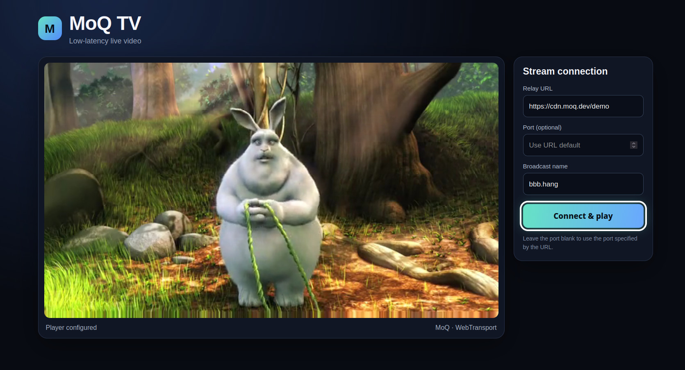

**MoQ-TV** is a project to bring Media over QUIC (MoQ) to Smart TVs — focused on low-latency broadcasting and smooth viewer experience for live streams.

## Features
- Low-latency broadcasting with QUIC transport  
- Reference/example applications for Smart TV platforms and beyond (initial targets below)  

## Platforms

*Current working implementations in bold:*

- **Web-based Smart TV apps and web browser (HTML5/JS)**
- **Linux**
- **LG webOS**
- Samsung Tizen - *coming soon*
- Android TV / Google TV - *coming soon*
- Roku (when feasible) - *coming soon*

## Project Structure
- `/docs` — design notes and integration guides  
- `/server` — see this for instructions to use moq-relay  
- `/clients`  
  - `/web` — HTML5 reference player (should work on most web browsers, including Smart TV browsers)
  - `/linux` — a native desktop player for MoQ streams using Rust, GTK4 and GStreamer
  - `/tizen` — example Tizen app  
  - `/webos` — example webOS app  
  - `/androidtv` — example Android TV app  
  - `/roku` — example Roku app  
- `/assets` — logo and images (including `moq-tv-navy.jpeg`)  
- `/scripts` — helper scripts to run test streams, app packaging, etc

## Getting Started

This repository includes clients for various platforms. See each client’s folder for setup, configuration, and deployment details.

- **Web:** Serve the files in [`clients/web`](clients/web) locally or deploy them to a web server. Open the page in a browser and enter a relay URL and broadcast name to connect.
- **Linux:** See [`clients/linux`](clients/linux) for full instructions for your distro.
- **LG webOS:** Install the latest `.ipk` from [moq-tv Releases](https://github.com/cathode-ray-tube/moq-tv/releases) on your TV using the webOS Developer Mode app and CLI.

## Contributing

All example apps are intentionally permissive for modification. Fork, adapt and open pull requests with improvements.

## License

This project is dual-licensed: MIT OR Apache-2.0, choose either. See `LICENSE-MIT` and `LICENSE-APACHE-2.0` in the repository root.

## Contact
    
Questions/pull requests welcome, particularly for any currently-unsupported platform.

